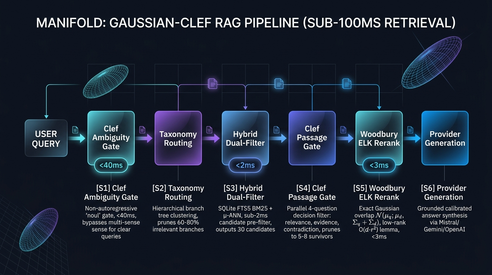

# Manifold — Gaussian-Clef RAG

> **Probabilistic retrieval-augmented generation on statistical manifolds with sub-100ms Cloudflare Clef decision routing, Woodbury-accelerated geometric kernels, and universal corpus generation.**
>
> Every chunk of knowledge is a Gaussian distribution, not a flat vector. Retrieval is information geometry, accelerated to production speed.

[](https://www.python.org/downloads/)
[](LICENSE)
[](pyproject.toml)
[](tests/)

---

## ⚡ Quick Start (3 Lines)

Install as a standalone library:

```bash
pip install -e .
```

Instantiate and search in Python — **runs 100% locally with zero API keys required**:

```python
from gaussian_rag import GaussianRAG

rag = GaussianRAG.create()
rag.add_texts([
    "Never outshine the master. Make those above you feel comfortably superior.",
    "Always say less than necessary. When you try to impress people with words, the more you say, the more common you appear.",
    "Conceal your intentions. Keep people off-balance and in the dark by never revealing the purpose behind your actions.",
])

results = rag.search("How should I behave around powerful people?", top_k=3)
for chunk in results:
    print(f"[{chunk.rank}] {chunk.knowledge.text} (confidence: {chunk.confidence:.3f})")
```

Ask questions with grounded answer synthesis (optional OpenAI, Gemini, or Mistral provider):

```python
answer = rag.query("How do you handle insecure superiors?")
print(answer)
```

---

## 🚀 Key Innovations & Architecture

Gaussian-Clef RAG transforms probabilistic retrieval from a multi-second research prototype into a **production-grade sub-100ms retrieval engine** by combining Information Geometry with non-autoregressive decision intelligence:

| Pillar | Capability | Technical Mechanism | Latency Impact |
|---|---|---|---|
| **Woodbury ELK Acceleration** | $O(d \cdot r^2)$ kernel evaluation | Uses low-rank matrix inversion lemma & Sylvester determinant theorem for Expected Likelihood Kernel | **150ms → <3ms** |
| **Cloudflare Clef Decision Routing** | Non-autoregressive ambiguity gating | Replaces slow autoregressive query dissolution with typed `noul` and `choice` questions via `@cf/cloudflare/clef-flash` | **1,500ms → <40ms** |
| **Native Dual-Store Ingestion** | Lockstep hybrid lexical-vector storage | Automatically indexes into dense covariance `KnowledgeStore` and embedded SQLite FTS5 `LexicalStore` simultaneously | **Sub-2ms candidate search** |
| **Taxonomy Branch Pruning** | Search space reduction | Hierarchical document clustering prunes 60–80%+ irrelevant candidate branches prior to reranking | **Eliminates 80% matrix ops** |
| **Clef 4-Question Passage Gate** | Noise, hallucination, and contradiction filter | Evaluates candidate chunks in parallel batches for relevance, evidence, and contradictions | **Prunes 30 → top 5–8 survivors** |
| **Universal Ingestion Engine** | Format-agnostic text processing | Natively ingests raw text, Markdown heading hierarchies, JSON/JSONL records, CSV tables, and directories | **Zero pre-processing boilerplate** |
| **Flexible Corpus Generator** | Unstructured text normalization & caching | Cleans dirty HTML, OCR line breaks, timestamps, and adaptively structures raw text with content-addressed cache | **Instant clean corpus creation** |

---

## 📐 End-to-End Pipeline Architecture



```
                                  USER QUERY
                                      │
                                      ▼
                        ┌───────────────────────────┐
                        │ [S1] Clef Ambiguity Gate  │ ── (Unambiguous: bypass multi-sense)
                        │ Non-autoregressive (noul) │
                        └─────────────┬─────────────┘
                                      │
                                      ▼
                        ┌───────────────────────────┐
                        │ [S2] Taxonomy Routing     │ ── (Prunes 60-80% candidate branches)
                        │ Hierarchical branch tree  │
                        └─────────────┬─────────────┘
                                      │
                                      ▼
                        ┌───────────────────────────┐
                        │ [S3] Hybrid Dual-Filter   │
                        │ SQLite FTS5 BM25 + ANN    │ ── (Sub-2ms lockstep candidate selection)
                        └─────────────┬─────────────┘
                                      │  (30 candidates)
                                      ▼
                        ┌───────────────────────────┐
                        │ [S4] Clef Passage Gate    │ ── (Filters noise, contradictions, gaps)
                        │ 4-question decision gate  │
                        └─────────────┬─────────────┘
                                      │  (Top 5-8 survivors)
                                      ▼
                        ┌───────────────────────────┐
                        │ [S5] Woodbury ELK Rerank  │ ── (<3ms exact manifold overlap scoring)
                        │ 𝒩(μ_q; μ_d, Σ_q + Σ_d)   │
                        └─────────────┬─────────────┘
                                      │
                                      ▼
                        ┌───────────────────────────┐
                        │ [S6] Provider Generation  │ ── (Optional: Mistral, Gemini, OpenAI)
                        │ Grounded answer synthesis │
                        └───────────────────────────┘
```

---

## 🧹 Flexible Corpus Generator & Raw Text Normalization

The `gaussian_rag.creator` package features an intelligent, multi-stage text normalization and adaptive corpus generation engine. It processes messy, unstructured pasted text (HTML/web clippings, OCR/PDF line breaks, chat transcripts, unformatted text blobs) into structured corpora with content-addressed caching.

### 1. Command-Line Interface (`data/generate_corpus.py`)

Generate benchmark corpora or process arbitrary raw text from files or stdin:

```bash
# 1. Generate standard 48 Laws of Power benchmark corpus
python data/generate_corpus.py --preset 48-laws -o data/48_laws_of_power.txt

# 2. Pipe messy, unformatted text from stdin directly into structured JSONL
cat raw_notes.txt | python data/generate_corpus.py --stdin -o corpus.jsonl

# 3. Clean messy OCR scan text into structured Markdown with hierarchy
python data/generate_corpus.py -i dirty_scan.txt -o clean_corpus.md -f markdown

# 4. Pass raw text directly via argument
python data/generate_corpus.py -t "Law 1: Never outshine the master..." -o laws.jsonl

# 5. Optional AI-assisted normalization using OpenAI-compatible endpoints
python data/generate_corpus.py -i ocr_scan.txt -o corpus.jsonl --ai
```

### 2. Programmatic Python Ingestion of Dirty Text

Ingest unformatted, messy text directly into your RAG instance with automatic HTML stripping, OCR hyphenation fixing, and structural detection:

```python
from gaussian_rag import GaussianRAG

rag = GaussianRAG.create()

# Raw messy HTML/OCR text
dirty_text = """
<p>Law 1: Never Outshine the Master<br/>
Always make those above you feel comfortably su-
perior. In your desire to please them, do not go too far.</p>

<p>Law 2: Never Put Too Much Trust in Friends<br/>
Former enemies are often more loyal than friends.</p>
"""

# Normalizes, structures, embeds as Gaussians, and updates both stores in 1 call:
rag.add_raw_text(dirty_text, title="48 Laws Excerpt")

results = rag.search("How to handle superiors?")
print(results[0].knowledge.text)
```

---

## 📦 Universal Format-Agnostic Ingestion

The `UniversalIngestor` natively parses, chunks, embeds, and dual-indexes arbitrary text formats into `KnowledgeStore` and SQLite FTS5:

```python
from gaussian_rag import GaussianRAG

rag = GaussianRAG.create()

# 1. Ingest Raw Strings
rag.add_texts([
    "Passage 1 content...",
    "Passage 2 content..."
], metadata=[{"source": "memo1"}, {"source": "memo2"}])

# 2. Ingest Markdown with Heading Hierarchy (Breadcrumbs preserved in metadata)
markdown_content = """# 48 Laws of Power
## Law 1: Never Outshine the Master
Always make those above you feel comfortably superior.
## Law 2: Never Put Too Much Trust in Friends
Friends will betray you more quickly than enemies.
"""
rag.add_markdown(markdown_content, document_id="48-laws")

# 3. Ingest Structured JSON / JSONL Records
records = [
    {"id": "doc_101", "text": "Customer agreement policy...", "department": "Legal"},
    {"id": "doc_102", "text": "Refund processing workflow...", "department": "Billing"}
]
rag.add_records(records, text_field="text", id_field="id")

# 4. Ingest Files (.txt, .md, .json, .jsonl, .csv)
rag.add_file("path/to/handbook.md")
rag.add_file("path/to/dataset.csv")

# 5. Ingest Entire Directory Trees Recursively
rag.add_directory("path/to/knowledge_base/")
```

---

## 💾 Persistence (Save & Load)

Save both dense covariance representations and SQLite FTS5 lexical indexes to disk with full cross-platform handle cleanup:

```python
# Save knowledge store + lexical index
rag.save("my_knowledge_store")

# Load existing store from disk in 1 line
from gaussian_rag import GaussianRAG

loaded_rag = GaussianRAG.load("my_knowledge_store")
results = loaded_rag.search("insecure bosses and power dynamics", top_k=5)
```

---

## 🔬 Mathematical Foundations

### 1. Multivariate Gaussian Representation

Every chunk $c$ is mapped to a probability distribution $\mathcal{N}(\mu_c, \Sigma_c)$ living on the statistical manifold $\mathbb{R}^d \times \text{SPD}(d)$:

$$\mathcal{N}(\mu_c, \Sigma_c), \quad \mu_c \in \mathbb{R}^d, \quad \Sigma_c \in \text{SPD}(d)$$

- **Mean vector $\mu_c$**: Semantic coordinates extracted via local `SentenceTransformer` or Gemini Cloud embeddings.
- **Covariance $\Sigma_c$**: Directional uncertainty modeled via diagonal plus low-rank decomposition:

$$\Sigma = \text{diag}(v) + L L^T, \quad v \in \mathbb{R}^d_+, \quad L \in \mathbb{R}^{d \times r}, \quad r = 8$$

### 2. Woodbury-Accelerated Expected Likelihood Kernel (ELK)

The canonical overlap score evaluates how much probability mass the query distribution places on the document distribution:

$$\text{Score}(Q, D) = \int \mathcal{N}(x; \mu_q, \Sigma_q) \mathcal{N}(x; \mu_d, \Sigma_d) \, dx = \mathcal{N}(\mu_q; \mu_d, \Sigma_q + \Sigma_d)$$

Using the **Woodbury Matrix Identity** and **Sylvester Determinant Theorem**, inversion of $(\Sigma_q + \Sigma_d) \in \mathbb{R}^{d \times d}$ runs in $O(d \cdot r^2)$ instead of $O(d^3)$:

$$(\text{diag}(v) + U V^T)^{-1} = \text{diag}(v)^{-1} - \text{diag}(v)^{-1} U (I_k + V^T \text{diag}(v)^{-1} U)^{-1} V^T \text{diag}(v)^{-1}$$

$$\det(\text{diag}(v) + U V^T) = \det(\text{diag}(v)) \det(I_k + V^T \text{diag}(v)^{-1} U)$$

This achieves **sub-3ms reranking across dozens of candidate passages**.

---

## 🛠️ CLI Usage & Evaluation

### Run End-to-End Evaluation on *The 48 Laws of Power*
Validates live Clef disambiguation, taxonomy pruning, FTS5 pre-filtering, passage gating, and exact-match retrieval:

```bash
python test_48_laws_e2e.py
```

### Ingest and Query via CLI
```bash
# Ingest documents into dual-store
python -m gaussian_rag.main ingest --input data/my_docs --output .my_store

# Query store with ELK metric
python -m gaussian_rag.main query --text "How should I handle rivals?" --store .my_store --metric elk
```

### Run Latency & Benchmark Verification
Proves sub-100ms retrieval latency across pipeline stages:

```bash
pytest tests/test_benchmark_latency.py -v
```

### Run Test Suites
```bash
# Run corpus generator tests
pytest tests/test_corpus_generator.py -v

# Run facade & universal ingestion tests
pytest tests/test_library_facade.py -v

# Run dual-store synchronization tests
pytest tests/test_dual_store_sync.py -v

# Run full test suite
pytest
```

---

## 🌐 3D Manifold Dashboard & Telemetry Server

Gaussian RAG includes a real-time 3D visualization dashboard with live stage latency telemetry:

```bash
# Start FastAPI backend (port 8001)
python dashboard_server.py

# In another terminal, start the Vite frontend (port 5173)
cd dashboard
npm install
npm run dev
```

Visit `http://localhost:5173` to explore:
- Interactive 3D manifold distributions (PCA-projected Gaussian ellipsoids)
- Live Server-Sent Events (SSE) telemetry showing stage-by-stage latencies
- Real-time taxonomy clustering and Clef decision traces

---

## ⚙️ Configuration & Environment Variables

Copy `.env.example` to `.env`:

```ini
# Optional Cloudflare Workers AI (Enables Clef decision routing & passage gating)
CLOUDFLARE_ACCOUNT_ID="your_account_id"
CLOUDFLARE_API_TOKEN="your_api_token"

# Optional Cloud LLM Generation (OpenAI / Gemini / Mistral)
GEMINI_API_KEY="your_gemini_key"
OPENAI_API_KEY="your_openai_key"
MISTRAL_API_KEY="your_mistral_key"
```

Configure core parameters in `config/config.yaml`:

```yaml
encoder:
  embedding_backend: "local"          # "local" (all-MiniLM-L6-v2) | "gemini_cloud"
  dimension: 384
  sigma_mode: "heuristic"             # "heuristic" | "learned" | "dissolver" | "entity_aware"
  low_rank: 8

retrieval:
  metric: "elk"                       # "elk" | "wasserstein2" | "fisher_rao"
  top_k: 5
  ann_candidates: 15

chunking:
  max_tokens: 128
  overlap_tokens: 16
```

---

## 📚 Public Python API Reference

```python
import gaussian_rag as gr

# 1. High-Level Facade
rag = gr.GaussianRAG.create(
    dimension=384,
    use_clef=False,           # set True to enable Cloudflare Clef passage gating
    use_generator=False       # set True to enable LLM response generation
)

# 2. Universal Ingestion & Normalization
normalizer = gr.TextNormalizer()
clean_text = normalizer.clean("<p>Some raw text...</p>")

generator = gr.CorpusGenerator()
documents = generator.generate(clean_text, title="My Corpus")

cache = gr.CorpusCache()
assistant = gr.OpenAICorpusAssistant()

# 3. Core Components
embedder = gr.GaussianEmbedder(sigma_mode="heuristic", rank=8)
store = gr.KnowledgeStore()
lexical = gr.LexicalStore()
retriever = gr.GaussianRetriever(store=store)
ingestor = gr.UniversalIngestor(embedder, store)
router = gr.TaxonomyRouter()

# 4. Data Models
from gaussian_rag import (
    GaussianKnowledge,        # 𝒩(μ, Σ) node with metadata
    QueryRepresentation,      # Query mean + covariance
    RetrievedChunk,           # Ranked chunk with confidence score & rank
    CorpusDocument,           # Cleaned document with structure metadata
)
```

---

## 📖 Complete Documentation Index

For in-depth guides and architectural blueprints, explore the [`docs/`](docs/) directory:

- [**Documentation Navigation Hub**](docs/README.md) — Unified sitemap for all guides
- [**Codebase Architecture (`CODEBASE.md`)**](docs/initial/CODEBASE.md) — Module hierarchy and dependency map
- [**Usage Guide (`USAGE.md`)**](docs/initial/USAGE.md) — Comprehensive developer workflows, CLI, and API examples
- [**Pipeline Specification (`PIPELINE.md`)**](docs/initial/PIPELINE.md) — Step-by-step description of the 6-stage retrieval and dual-store ingestion pipelines
- [**Design Decisions (`DECISIONS.md`)**](docs/initial/DECISIONS.md) — Architectural decision records (DD-01 through DD-14)
- [**Information Geometry Theory (`THEORY.md`)**](docs/initial/THEORY.md) — Mathematical formulation of statistical manifolds and ELK
- [**PyTorch SigmaHead (`ABOUT.md`)**](docs/ABOUT.md) — Learned covariance estimation and continual learning
- [**Concept Blueprints (`concepts/`)**](docs/concepts/README.md) — Multi-agent disambiguation and polysemy specifications

---

## 📜 License

Apache-2.0 License. See [LICENSE](LICENSE) for details.
